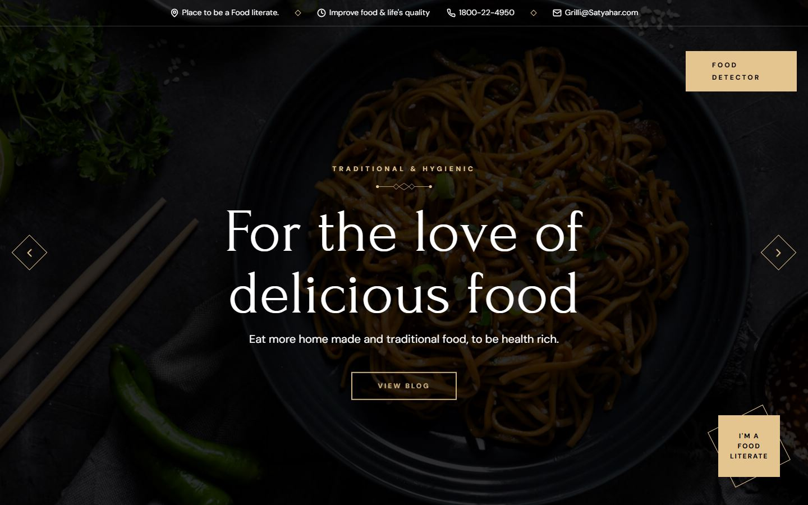
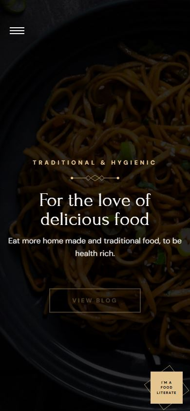

# SatyaAhaar

> Food literacy, one scan at a time.

**SatyaAhaar** is a food-literacy web app that helps you understand what is really inside the food you buy. Scan a product barcode to see its Nutri-Score, Eco-Score, and nutrition facts, or search a recipe collection by the ingredients you already have.

[](https://github.com/KushalNerpagar/satyaahaar/actions/workflows/deploy.yml)
[](#testing)
[](LICENSE)

**[Live demo →](https://kushalnerpagar.github.io/satyaahaar/)**



## Features

| Feature | What it does |
| --- | --- |
| **Landing page** | A responsive, animated introduction to food literacy with product highlights, recipes, and a donation/contact form. |
| **Barcode scanner** | Enter a barcode or scan one with your camera to fetch a product from Open Food Facts. |
| **Product details** | Deep-linkable product pages with Nutri-Score, Eco-Score, per-100 g nutrition, categories, and ingredients. |
| **Recipe finder** | Search TheMealDB by ingredient, browse results with skeleton states, and open an accessible recipe dialog. |

### Deep links

Every route works when refreshed or shared — including product pages:

```
/#/
/#/scanner
/#/product/8901030895601
/#/recipes
```

Hash routing is intentional: GitHub Pages needs no rewrite rules.

<p align="center">
  
</p>

## Tech stack

- **React 18** + **Vite 6**
- **Tailwind CSS v4** with a token layer ported from the original design
- **React Router 7** (hash router)
- **lucide-react** icons, self-hosted **Forum / DM Sans** fonts
- **Vitest + React Testing Library** for unit and component tests
- **Playwright** for smoke tests across routes and breakpoints
- **Open Food Facts** and **TheMealDB** public APIs

No CDN scripts, no `innerHTML`, no 2,000-line stylesheet.

## Architecture

```
src/
├─ components/
│  ├─ layout/      PageHeader, ScrollToTop, RouteTitle
│  └─ ui/          Button, SectionHeading, PageLoader, SkipLink
├─ features/
│  ├─ landing/     LandingPage, content.jsx, hooks/, sections/
│  ├─ scanner/     ScannerPage, ProductPage, Html5QrcodePlugin
│  └─ recipes/     RecipeSearchPage
├─ lib/
│  ├─ api/         openfoodfacts.js, themealdb.js (timeouts, abort, typed errors)
│  ├─ formatters.js
│  └─ assets.js
├─ styles/         Tailwind import + @theme design tokens
└─ test/           Vitest setup
e2e/               Playwright smoke tests
```

Design decisions worth calling out:

- **Single API layer.** Every request goes through `lib/api`, which normalises timeouts and failures into an `ApiError` with a stable `code` (`network`, `timeout`, `not-found`, `aborted`, `invalid`).
- **Lazy routes.** Each feature is code-split; the heavy `html5-qrcode` bundle only loads on the scanner page.
- **Accessibility.** Skip links, focus-visible rings, focus return in the mobile drawer, labelled form fields, a focus-trapped recipe dialog, and reduced-motion support.
- **Resilient product pages.** Product data is refetched by barcode when router state is missing, so a refresh or shared link still works.

## Getting started

Requires **Node 20+**.

```bash
npm install
npm run dev
```

Open the URL printed by Vite. The app is served under `/satyaahaar/` in production; in dev, Vite handles it automatically.

### Scripts

| Script | Purpose |
| --- | --- |
| `npm run dev` | Start the Vite dev server |
| `npm run build` | Production build into `dist/` |
| `npm run preview` | Preview the production build locally |
| `npm run lint` | ESLint (flat config) |
| `npm run format` | Prettier |
| `npm test` | Unit/component tests (Vitest) |
| `npm run test:watch` | Vitest in watch mode |
| `npm run test:e2e` | Playwright smoke tests (builds + previews automatically) |

## Testing

```bash
npm test        # 28 unit and component tests
npm run test:e2e  # 9 Playwright smoke tests
```

Coverage includes:

- API success, empty, error, timeout/abort, and validation paths for both services
- Formatters and tag cleanup
- Product deep links, nutrition rendering, and error recovery
- Recipe search, empty state, modal open/close, and Escape handling
- Navigation, the mobile drawer, and horizontal-overflow checks at **375 / 768 / 1280 / 1440 px**
- A console-error guard across all core routes

The Playwright config starts `vite preview` on port `4173`. Run `npx playwright install chromium` once before the first e2e run.

## Data sources

- [Open Food Facts](https://world.openfoodfacts.org/) — product, nutrition, and score data. Open data under the ODbL.
- [TheMealDB](https://www.themealdb.com/) — recipe search and details.

Both are public, rate-limited services. The client sends no API keys and stores nothing.

## Deployment

Pushing to `main` triggers `.github/workflows/deploy.yml`, which lints, tests, builds, and publishes `dist/` to GitHub Pages.

One-time setup: **Settings → Pages → Build and deployment → Source: GitHub Actions**.

Since the app lives at `https://kushalnerpagar.github.io/satyaahaar/`, `base` is set to `/satyaahaar/` in `vite.config.js`. If you fork it under a different repository name, update that value.

## Attribution

The landing-page visual design is adapted from the MIT-licensed **[Grilli](https://github.com/codewithsadee/grilli)** template by [codewithsadee](https://github.com/codewithsadee). The markup was rebuilt as React components with Tailwind CSS; the original stylesheet and scripts are not shipped.

This project consolidates three earlier college projects into one codebase:

- [05kaliki/home](https://github.com/05kaliki/home) — the original static landing page
- [05kaliki/Recipe](https://github.com/05kaliki/Recipe) — the barcode scanner
- [05kaliki/Meal_search](https://github.com/05kaliki/Meal_search) — the recipe search

## License

[MIT](LICENSE)
